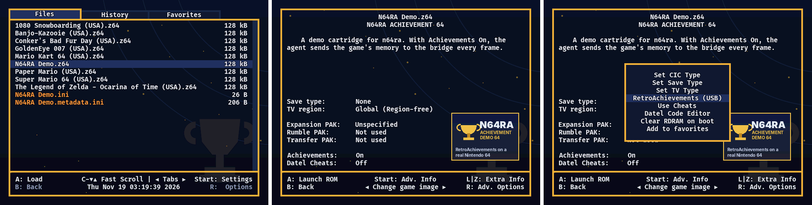
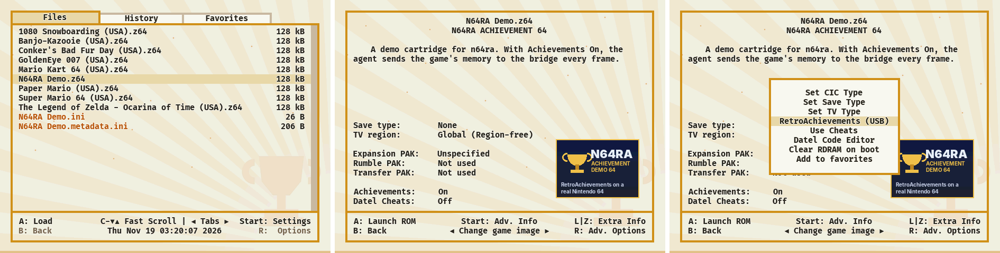

# n64ra

RetroAchievements on a real Nintendo 64, through a SummerCart64.

```
N64 (agent) --SC64 USB--> bridge (PC or Pi) --UDP--> xeRAbora (rcheevos, your RA account)
```

The menu on the SC64 (a patched N64FlashcartMenu) installs a small agent
alongside the game. Every frame the agent reads the memory the game's
achievements watch and sends it out of the SC64's USB port. The bridge
forwards it to xeRAbora, which checks the achievements and unlocks them
on your RetroAchievements account.

Needs: an SC64, an Expansion Pak (the agent lives in its top 128 KB), a
USB cable from the SC64 to the machine running the bridge, and xeRAbora.

## Using it

Downloads (the Mac app and the two menus) are on the
[Releases page](https://github.com/croissantpigbear/n64ra/releases/latest).

1. Copy `menu/sc64menu.n64` to the root of the SC64's SD card (it
   replaces the stock menu; keep a copy of yours). That build has the
   Trophy Night theme; for Gold Rush, copy `menu/sc64menu-goldrush.n64`
   instead and rename it `sc64menu.n64`.
   For box art and game descriptions on the game screen, extract the
   menu's [metadata pack](https://github.com/n64-tools/n64-flashcart-menu-metadata/releases)
   into `menu/` on the SD card (`menu/metadata/N/F/U/E/...`).
2. In the menu, pick a game, open its options (R), and set
   **RetroAchievements (USB)** to Enabled. The info screen shows
   "Achievements: On". It is remembered per game. Cheats are off while
   it is on.
3. Plug the SC64's USB port into the computer and run the bridge. On a
   Mac, use the **N64RA Bridge** app (`N64RA-Bridge-mac.zip` from
   Releases; source in `app/`): press Start and it finds the SC64, starts
   xeRAbora and shows the game, the frames and the unlocks. Or from a
   terminal (any PC or a Pi):

   ```
   pip install pyserial
   python3 bridge/n64ra_bridge.py                     # finds the SC64 and xeRAbora
   python3 bridge/n64ra_bridge.py --pc 192.168.1.20   # or name xeRAbora's address
   ```

4. Start the game. The bridge logs the game, its hash, the watch list
   and a running count of snapshots.

If xeRAbora says a game is unknown to RetroAchievements, the ROM is not
one of the dumps its achievement set lists (RetroAchievements matches the
exact file). Check the file on the SD card:

```
python3 bridge/n64ra_bridge.py --hash "/Volumes/SC64/Conker.z64"
```

It prints the RetroAchievements hash (it should equal the one the bridge
logged; if not, tell us), the SHA-1 to compare with No-Intro, and the
header's revision. The game's page on retroachievements.org lists the
dumps it supports (Supported Game Files).

## Themes

The menu build comes in two themes. Each sets the menu's colours (text,
borders, tabs, highlights, scroll bars, dialogs) and has a built-in
background that shows until you set your own (a background you pick in
the menu still takes over, tinted to suit the theme).

**Trophy Night** (deep navy and trophy gold, the default, `sc64menu-trophynight.n64`):



**Gold Rush** (cream and gold, dark ink, `sc64menu-goldrush.n64`):



Left to right: the file browser, a game's screen (Achievements: On, with
its box art and description from `menu/metadata`), and the game's
options (R), where RetroAchievements (USB) is turned on. The game here
is a demo cartridge made from the test ROM, with its own box art.

A background set in the stock menu is not carried over: this menu keeps
its own (`menu/cache/background-n64ra.data`). The backgrounds are drawn
by `menu/theme/make_theme_bg.py`; the screenshots are taken in gopher64
by `test/screenshots/shoot.sh`.

## How it works

**Getting in.** The menu stages the agent at 80720000h and points the
last instruction of the game's boot code (IPL3's `jr t1` into the game)
at the agent's patcher, the same way its cheat engine does. The patcher
moves the agent to 807E0000h, puts a jump to it at the general exception
vector (80000180h) and sets a CPU watchpoint on that vector. When the
game installs its own exception handler, the watchpoint fires and the
agent moves the game's handler to 80000120h (Parasyte's trick, also used
by the menu's cheat engine). From then on the agent sees every exception
first and continues to the game's handler.

**Frames.** On each VI interrupt (one per frame) the agent takes a
snapshot: the watch list's values, and its pointer chains (xeRAbora's
RAN2 nodes) resolved. Memory is read the way rcheevos sees N64 memory:
RetroAchievements address A is the byte at 80000000h + (A xor 3), as in
the emulators. If a VI arrives in the instant between the agent's check
and the game's handler, the agent notices from the COP0 count and takes
that frame late; the snapshot is marked so.

**The cartridge bus.** Games stream from the cartridge all the time
through the PI, and the agent shares it. It uses the PI only when no DMA
or I/O is under way, and leaves the PI interrupt as the game expects it.
A snapshot waits for the next free moment if it must.

**USB.** Everything goes through the SC64's 8 KB data buffer
(1FFE0000h), which sits outside the ROM's memory, so games of any size
work, 64 MB ones (Conker's Bad Fur Day, Resident Evil 2, Pokémon
Stadium 2) included. The agent DMAs each packet into the buffer's 6 KB
out half and asks the SC64 to send it (USB_WRITE); a snapshot bigger
than that goes in several packets. The watch list comes down into the
2 KB in half (USB_READ) in pieces, each acknowledged by the agent before
the bridge sends the next. Snapshots are double-buffered, so a new frame
never waits for the last one's packets. The bridge reads the ROM back
over USB to hash it (MD5 of the big-endian ROM, as rcheevos does). For a 64 MB ROM
the last 128 KB come from the SC64's flash, where the menu puts them
(ROM shadow), and anything past 64 MB from ROM extended.

Packets are kept to one 512-byte USB transfer each: on a Mac the SC64's
USB link stalled partway through bigger ones. Most frames go as a DELTA,
only the bytes that changed since the bridge's copy; a whole snapshot
(SNAP, in parts sent back to back) goes every 120 frames, when too much
changed for one packet, or when the bridge missed a delta and asks
(KEY_REQ). If the link stalls anyway, the bridge reopens the port and
resets the SC64's USB side, and reads the agent's status block from the
SC64's buffer to say what happened.

Packets (big-endian, see `agent/n64ra.h`): HELLO (ROM header, size,
memory, list state), SNAP (header with offset and part, then that part
of xeRAbora's snapshot), DELTA (header with the base seq, then runs of
offset, length, bytes), LIST (total, offset, piece), LIST_ACK (next
offset, list state), NOLIST, HELLO_REQ, KEY_REQ.

## Limits

- Expansion Pak required.
- Retail games only: the agent hooks the retail (libultra) boot code,
  like the menu's cheats. Homebrew built with libdragon's IPL3 boots
  without achievements.
- Cheats and achievements are exclusive (RetroAchievements' hardcore
  rules agree).

## Status

**Works on a real console.** Tested on an NTSC N64 with an Expansion
Pak and a SummerCart64, bridge and xeRAbora on a Mac, with Conker's Bad
Fur Day (64 MB, CIC 6105, 131 addresses and 180 pointer chains):
the game is identified, its set loads, an achievement unlocked, and
every frame reaches xeRAbora (60 a second, about 99% of them as
changes only) with no USB stalls over a long session.

Found on hardware and fixed: the last 128 KB of a 64 MB ROM live in the
SC64's flash (ROM shadow), not its SDRAM, so the bridge reads them from
there; a debug build of the menu writes its USB log into the last 8 MB
of the ROM space (build with `FLAGS=-DNDEBUG`); CIC 6105 games keep the
RDRAM size at 800003F0h until libultra sets osMemSize; the SC64's USB
link stalled on a Mac partway through packets bigger than one 512-byte
USB transfer, so packets are now kept to one (deltas, whole snapshots
in parts).

Also tested in the gopher64 emulator, which emulates the SC64 and its
USB (with `test/gopher64-n64ra.patch`: the CPU watchpoint gopher64
lacks, and USB transfers through the SC64's data buffer, which the real
SC64 firmware allows and gopher64 did not). `test/run_test.py` runs a
test game that installs its exception handler as libultra does and
streams 32 KB from the ROM over the PI about twice a frame, the agent,
the bridge and a mock xeRAbora:

- the bridge's hash equals rcheevos's for the ROM
- with a 1,614-value set (6.5 KB snapshot, sent whole in 15 parts a
  frame): one snapshot per frame, every value right (direct values,
  unaligned, Expansion Pak, out of range, pointer chains)
- with a small set: one snapshot per frame, nearly all as changes only;
  with 2% of them dropped on purpose, the bridge asks for a whole one
  and carries on
- the game's 32 KB DMAs meanwhile, none corrupted, each with its PI
  interrupt

`test/run_gui_test.py` runs the Mac app's window against the same.

## Layout

| Folder | What |
|---|---|
| `agent/` | the agent: `entry.S` (patcher, exception engine), `agent.c`, `n64ra.h` |
| `docs/` | screenshots of the themes |
| `app/` | N64RA Bridge, the Mac app: `n64ra_gui.pyw` (the window), `build_mac.sh`, `macos/` (launcher, Info.plist, icon) |
| `bridge/` | `n64ra_bridge.py`: SC64 (USB serial) or gopher64 (TCP) to xeRAbora |
| `menu/` | `n64flashcartmenu-n64ra.patch` for N64FlashcartMenu `cdb9eec`, the built menus (`sc64menu.n64` Trophy Night, `sc64menu-goldrush.n64`), `theme/` |
| `test/` | emulator test: test game, launcher ROM, `run_test.py`, gopher64 patch |

## Building

Needs the libdragon toolchain (`N64_INST`, preview branch libdragon).

```
cd agent && make                      # agent.bin, agent_blob.h (DEBUG=1: IS-Viewer logging)

git clone -b n64ra https://github.com/croissantpigbear/N64FlashcartMenu && cd N64FlashcartMenu
git submodule update --init
# (or: upstream Polprzewodnikowy/N64FlashcartMenu at cdb9eec + menu/n64flashcartmenu-n64ra.patch)
cp ../n64ra/agent/agent_blob.h src/boot/n64ra_agent.h   # after changing the agent
make FLAGS=-DNDEBUG                   # output/sc64menu.n64 (Trophy Night)
make FLAGS=-DNDEBUG THEME=goldrush    # Gold Rush
```

Build it as the menu's own releases are, with `FLAGS=-DNDEBUG`. A debug
build logs over USB, and libdragon keeps that log in the last 8 MB of the
ROM's space (03800000h), which overwrites part of a 64 MB game and
changes its hash.

Emulator test:

```
git clone --recursive https://github.com/gopher64/gopher64 && cd gopher64
git apply ../n64ra/test/gopher64-n64ra.patch
cargo build --release --no-default-features
# in gopher64's config.json: "emulation": { "usb": true }
cd ../n64ra/test/game && make && cd ../launcher && make
cd .. && RC=path/to/rcheevos && gcc -I$RC/include -I$RC/src -o rchash rchash.c $RC/src/hash/*.c $RC/src/util/*.c
./run_test.py path/to/gopher64 60     # needs xvfb-run and a Vulkan driver (lavapipe works)
N64RA_TEST_EXTRA=0 ./run_test.py path/to/gopher64 30   # small watch list
```
